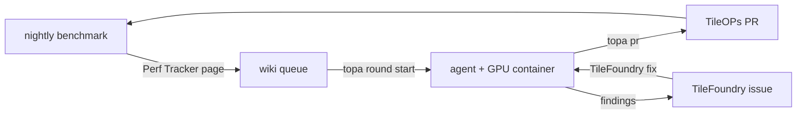

# How a round works

One round is one agent making one [TileOPs](https://github.com/tile-ai/TileOPs) op reach
its fastest comparator:

1. The TileOPs nightly writes a Perf Tracker page to the TileOPs wiki: the ops behind, in
   the order to work them, with each op's rows. `topa hunt` reads the newest page and shows
   what already works each op.
2. `topa round start <Op>` creates a TileOPs worktree and branch, a TileFoundry checkout,
   a container with one GPU, and a round directory with the brief. The brief carries the
   op's rows and its earlier attempts: the upstream `[Perf]` PRs that name the op, and its
   rounds on this machine. Then it starts the round agent in a herdr pane and tells it to read
   the brief.
3. The agent runs on the host. A PreToolUse hook sends each shell line that runs anything
   but `git`, `gh`, the reviewer, `topa`, a file operation or a text tool into the round's
   container over SSH.
4. The agent follows the [perf brief](../src/topa/kit/round/perf/brief.md) through the
   [states](#states), from classifying the comparators to opening the PR with `topa pr`.
   That command checks the evidence, opens the PR from your fork, and posts the test plan
   and the evidence as five comments.
5. TileFoundry problems the agent hits go into one TileFoundry issue.
6. A round that misses the bar on some rows still opens its PR when it beats main and
   slows no row; the unmet rows go under Result And Limitations. Otherwise it opens no PR
   and writes its stop records in `report.md`.
7. `topa round stop <slug> [--rm]` stops the agent, archives its transcripts, and with
   `--rm` releases the container, the worktree and the checkout.



A merged PR moves the nightly. A TileFoundry fix reaches the next round.

## Kinds and admission

`topa round start` admits a round under the ledger lock and creates nothing until every
check passes. It fetches upstream main first; that commit is the round's base.

| Command | Kind |
| --- | --- |
| `topa round start <Op>`, `<Op>`'s manifest entry `spec-only` | new-op; the issue is the one open issue whose title names `<Op>`, or none |
| `topa round start <Op> --issue <N>`, `<Op>` spec-only | new-op on issue N |
| `topa round start <Op>`, `<Op>` implemented | perf on the op's row of the wiki queue |
| `topa round start --issue <N>`, title starts with `[Perf]` | perf on the workloads the issue lists |
| `topa round start --issue <N>`, title names exactly one spec-only op | new-op on that op |
| `topa round start --issue <N>`, anything else | general |

A title names `<Op>` when `<Op>` is a whole word of it. Admission refuses:

- an op with no manifest entry under `src/tileops/manifest/spec/`, or several;
- a spec-only entry without a `family`, or with a workload without a `label`;
- an implemented op that is not in the queue, or that comes with `--issue`;
- an issue that is closed, that does not name the op, or that names several spec-only ops;
- several open issues that name the op;
- for a new op: an issue assigned to someone else, or an open or draft PR by someone else
  whose title or body names the op or closes the issue;
- a live round on the same op or issue, or more live rounds than `max_rounds`.

A round on an issue assigns the issue to you when no one holds it, and unassigns it if the
start fails.

| Kind | Contract | PR title | PR links the issue with |
| --- | --- | --- | --- |
| perf | the [perf brief](../src/topa/kit/round/perf/brief.md), with the earlier attempts at the op | `[Perf][foundry][<Family>] ...` | `Refs #N`; the nightly confirms the result |
| new-op | the [new-op brief](../src/topa/kit/round/new-op/brief.md) on every workload `label` x dtype case of the entry; no earlier attempts | `[Feat][foundry][<Family>] ...` | `Closes #N` when there is an issue |
| general | understand, write a failing test, implement, verify, review, clean up, PR | `[<Type>] ...` | `Closes #N` |

- A new op has no main, so its Performance table has no main column, and `below bar` asks
  that the op is implemented, correct and tested, and that its stop records hold.
- A new op may wrap an existing kernel; its twin check still runs.
- The `[foundry]` origin in a title makes TileOPs add the `foundry` label to the PR.

## States

A perf or new-op round moves along one state graph. `topa round start` puts it in REQ; the
agent runs `topa round transition <state> --reason "..."` at each exit, and `topa round
status` shows the state.

```text
REQ -> HIR -> FLOOR -> [OP, new-op only] -> IMPL -> CLEAN -> REVIEW -> FINAL -> PR -> CI -> DONE
```

- REVIEW exits to PR once the PR is published; PR and CI return to CLEAN after a change.
- Any active state may repeat, return to REQ or to a rework state behind it (HIR, FLOOR,
  OP, IMPL, CLEAN), or stop (STOPPED).
- The command refuses any other move, and a move whose checks fail; each move is a
  `transition` event in `ledger.jsonl`.
- `topa pr` runs only in state PR.

| Edge | Checks |
| --- | --- |
| HIR -> FLOOR | the `reference_check` record |
| FLOOR -> OP / IMPL | a floor record per row (new-op: per admitted case); at least two placements, one chosen |
| OP -> IMPL | the manifest diff is the op's `status: spec-only` turned `implemented`, alone; `base_tests` records the new tests failing on the base |
| IMPL -> CLEAN | `schedule`, `twin_check`, `iterations`, `benchmark`; the Performance table, a row per row (new-op: per admitted case), under the bar of the result; perf: the declared production kernel changed |
| REVIEW -> PR | the round has published its PR (a `pr` event in the ledger) |
| any -> STOPPED | `## Stop records` in `report.md` |

## The gate

`topa gate` runs the shared checks on every round: the commit binding, the recorded tests
and reviews, the PR text, and the forbidden paths of the kind. A perf or new-op round also
passes the checks of its edges again, `findings.json`, and the `Op:`, `Benchmark:` and
`Result:` lines.

| Kind | Forbidden paths |
| --- | --- |
| perf | `benchmarks/`, `workloads/`, `src/tileops/manifest/`, `scripts/`, `.github/` |
| new-op | `scripts/`, `.github/`; in the manifest, all but the op's status line |
| general | none |
