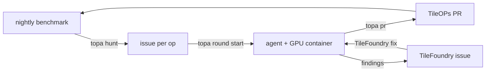

# How a round works

One round is one agent working one [TileOPs](https://github.com/tile-ai/TileOPs) issue:

1. `topa hunt` grades the newest nightly benchmark the way the benchmark site does and
   lists the ops that are behind, with the issue that names each one.
2. `topa issue new <Op>` files one perf issue per op, assigned to you.
3. `topa round start <issue>` creates a TileOPs worktree and branch, a TileFoundry
   checkout, a container with one GPU, and a round directory with the brief. Then it
   starts Claude Code in a herdr pane and tells it to read the brief.
4. The agent runs inside the round's container, like a dev container: every command it
   runs has the GPU, CUDA, TileFoundry and TileOPs. It reuses the host's Claude Code login
   and settings and the host's `git` and `gh` credentials, all mounted, so nothing logs in
   per round. The herdr pane runs `rounds/<slug>/bin/claude`, which enters the container
   with `docker exec`.
5. The agent writes HIR, analyzes and measures it with TileFoundry, writes the TileLang
   kernel, and runs `topa pr`. That command checks the evidence and opens the PR from
   your fork. TileFoundry problems it hits go into one TileFoundry issue.
6. `topa round stop <slug> [--rm]` stops the agent, archives its transcripts, and with
   `--rm` releases the container, the worktree and the checkout.

A merged PR moves the nightly. A TileFoundry fix reaches the next round.
